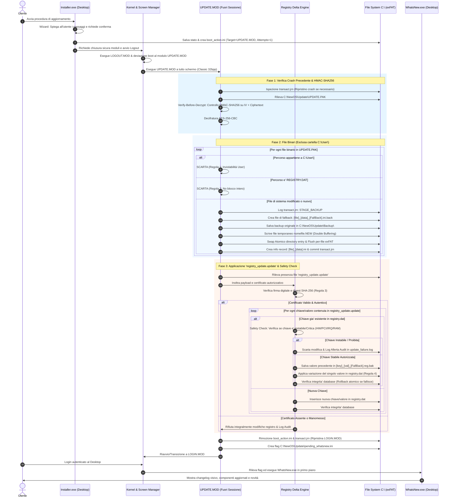

# Piano Architetturale e di Implementazione: Subsystem di Aggiornamento Guidato — NewOS V1 (64-bit)

Il presente documento definisce la progettazione tecnica, i componenti software, il flusso operativo, le strutture dati e le **strategie avanzate di mitigazione dei rischi** per l'implementazione del sottosistema di aggiornamento del sistema operativo **NewOS V1**.

---

## 0. Regole Primarie Assolute e Vincoli di Sicurezza

> [!IMPORTANT]
> Le seguenti quattro regole hanno priorità gerarchica assoluta e guidano l'intera architettura dell'Update Subsystem:

### Regola Primaria 1: Inviolabilità Assoluta della Cartella `C:\User\`
- **Principio**: La cartella `C:\User\` (inclusi i profili utente come `User\Morgan\`, documenti, desktop, configurazioni personali e cartelle progetti) **non deve mai essere toccata, modificata, sovrascritta o cancellata** durante alcuna fase di aggiornamento o rollback.
- **Enforcement Tecnico**:
  - `pack_update.js` scarta ed esclude preventivamente qualsiasi path contenente o iniziante per `User/` o `User\`.
  - `UPDATE.MOD` a runtime verifica ogni record: se l'indirizzamento punta a `User\`, il pacchetto viene bloccato con codice di violazione di sicurezza `ERR_USER_FOLDER_PROTECTED`.

---

### Regola Primaria 2: Divieto Assoluto di Sostituzione in Blocco di `registry.dat`
- **Principio**: Il database di configurazione `C:\NewOS\Registry\registry.dat` **non deve mai essere sostituito in blocco** da un file monolitico presente nell'archivio.
- **Motivazione**: Una sostituzione integrale cancellerebbe le chiavi hardware scoperte durante il boot, i driver registrati attivi, le impostazioni personalizzate del display e dell'utente, causando con certezza instabilità, corruzione del boot o kernel panic.

---

### Regola Primaria 3: Certificato di Autorizzazione Obbligatorio e File `registry_update.update`
- **Principio**: Qualsiasi modifica, aggiunta o variazione delle chiavi di `registry.dat` deve essere generata da un applicativo autorizzato e convalidata da un **Certificato Digitale di Autorizzazione (`REG_AUTH_CERT`)** integrato nel file differenziale **`registry_update.update`**.
- **Applicativo Windows (`NewOS Registry Update Editor`)**: 
  - Applicativo dedicato in ambiente Windows distribuito nella cartella di root del progetto: **`registry_update_editor/`** (`registry_update_editor/RegistryUpdateEditor.exe`).
  - Carica e analizza la struttura ad albero dal file master `registry.dat` (decifrando l'envelope AES-256 se protetto), permettendo all'amministratore di esplorare i rami principali (`HKEY_LOCAL_MACHINE`, `HKEY_CLASSES_ROOT`, ecc.) e creare/modificare chiavi in "Modalità Update".
  - Salva e firma crittograficamente il file unificato **`registry_update.update`** contenente la specifica delle nuove chiavi, dei valori e del certificato autorizzativo.
- **Innesco nel Pacchetto**: Il file `registry_update.update` viene inserito (*innescato*) all'interno di `UPDATE.PAK` (o distribuito per il modulo `UPDATE.MOD`).
- **Validazione a Runtime**: `UPDATE.MOD` esamina la firma, il digest SHA-256 e la validità crittografica del payload. Se il certificato è assente, non valido o alterato, **nessuna scrittura sul registro viene consentita**.

---

### Regola Primaria 4: Modifica Granulare (Singolo Valore), Fallback Atomico e Safety Check su Chiavi Instabili
- **Principio**: L'unico modo ammesso per aggiornare `registry.dat` è la **modifica mirata del singolo valore** all'interno del database binario/strutturato, con rigoroso **Safety Check anti-instabilità**.
- **Controllo di Sicurezza su Chiavi Corrispondenti (Anti-Instabilità)**:
  - Quando `UPDATE.MOD` processa `registry_update.update` e rileva che una chiave bersaglio **esiste già** all'interno di `registry.dat`, esegue un controllo di sicurezza preventivo:
    - **Verifica Chiavi Instabili / Critiche**: Viene consultata la matrice delle chiavi hardware dinamiche e volatili (es. IRQ, I/O base, puntatori DMA configurati al boot dal BIOS/PCI, informazioni memoria fisica e dati runtime protetti).
    - **Protezione Attiva**: Se la chiave è classificata come **Instabile / Proibita**, l'aggiornamento della chiave viene **rigettato**, salvando una segnalazione nell'audit trail `update_failure.log` senza interrompere le chiavi sicure.
    - **Chiavi Stabili Autorizzate**: Se la chiave è stabile (es. policy di sistema, versioni, estensioni file, impostazioni software), l'aggiornamento viene autorizzato ed eseguito con salvataggio del fallback.
- **Protocollo Transazionale con Fallback**:
  1. **Lettura Stato Precedente**: Prima di applicare la variazione su una chiave autorizzata, viene estratto il valore corrente.
  2. **Generazione Fallback Record**: Viene creato il file di rollback `C:\NewOS\Update\[key]_[val]_[date]_[FallBack].reg.bak` contenente il valore originale, il tipo (`REG_SZ`, `REG_DWORD`), la data e l'hash.
  3. **Applicazione Atomica**: Viene aggiornato esclusivamente il valore bersaglio in memoria/disco.
  4. **Verifica Integrità**: Viene ricalcolato il checksum del database. In caso di discrepanze o errore I/O, il valore precedente viene immediatamente ripristinato (Rollback Atomico Istantaneo).

---

## 1. Mitigazione Rischi e Architettura di Resilienza

### 1.1 Mitigazione exFAT (Assenza di Journaling nativo)
Poiché exFAT non possiede un file system journal, un'interruzione di alimentazione durante la sovrascrittura di un file potrebbe corrompere la catena dei cluster o la directory entry. Per eliminare questo rischio:
1. **Scrittura Shadow & Swap Atomico (Double Buffering)**:
   - Il nuovo file non viene **mai scritto direttamente sopra il file originale**.
   - Viene scritto come file temporaneo nella stessa cartella: `nomefile.ext.NEW`.
   - Vengono scritti e sincronizzati tutti i cluster dati (`vfs_sync_file`).
   - Viene eseguito lo swap atomico della directory entry: il vecchio file viene rinominato in `.BAK` e il file `.NEW` prende il nome definitivo.
   - Infine viene eliminato il file temporaneo residuo.
2. **Commit e Flush a ogni singolo file (Per-File Sync)**:
   - Invece di eseguire un unico `vfs_sync()` alla fine dell'intero pacchetto, `UPDATE.MOD` forza il commit dei settori FAT e della directory entry **al termine di ogni singolo file aggiornato**.
3. **Micro-Journaling di Transazione (`C:\NewOS\Update\transact.jrn`)**:
   - Un file di stato pre-allocato traccia lo stato della transazione in corso:
     `[ID:42] -> [FILE:CMD.EXE] -> [STAGE:BACKUP_DONE] -> [STAGE:NEW_WRITTEN] -> [STAGE:COMMITTED]`.

---

### 1.2 Gestione del Crash durante la Scrittura & Idempotenza di `UPDATE.MOD`
1. **Boot Watchdog & Tentativi Massimi (`Attempts Counter`)**:
   - Il file `C:\NewOS\Boot\boot_action.ini` contiene il parametro `UpdateAttempts=1` e `MaxAttempts=2`.
   - Se il sistema crasha o perde alimentazione durante l'aggiornamento, al riavvio UEFI/BIOS caricherà nuovamente `UPDATE.MOD`.
   - `UPDATE.MOD` incrementa il contatore: se `UpdateAttempts > MaxAttempts`, il sistema dichiara lo stato di emergenza, avvia il **Rollback Automatico di Emergenza** ripristinando tutti i file dai backup `.ini.back`, rimuove `boot_action.ini` e ripristina `LOGIN.MOD` per garantire che il PC riparta sempre.
2. **Crash Recovery all'Avvio di `UPDATE.MOD` (Idempotenza)**:
   - All'avvio, `UPDATE.MOD` legge `transact.jrn`:
     - Se trova un'operazione non conclusa (`STAGE:NEW_WRITTEN` senza `COMMITTED`), rimuove il file temporaneo `.NEW` e ripristina la coerenza del file precedente.
     - Riprende l'elaborazione dal file interrotto (**Resume Idempotente**), senza ricominciare da zero e senza duplicare i file già validati.

---

### 1.3 Integrità Crittografica: "Encrypt-then-MAC" (HMAC-SHA256)
Per proteggere il container `UPDATE.PAK` non solo dalla lettura non autorizzata, ma specificamente da alterazioni malevole dei blocchi (attacchi padding oracle e bit-flipping):
1. **Schema Encrypt-then-MAC**:
   - Il pacchetto viene cifrato in **AES-256-CBC**.
   - Viene calcolato un **HMAC-SHA256 (32 byte)** sull'unione dell'IV e del Ciphertext:
     $$\text{AuthTag} = \text{HMAC-SHA256}(K_{auth}, IV \parallel \text{Ciphertext})$$
   - L'AuthTag viene integrato nell'header del file `UPDATE.PAK` (`NOSPAK20`).
2. **Verifica Preliminare Globale (Verify-Before-Decrypt)**:
   - Prima di decifrare qualsiasi blocco AES e prima di toccare il disco, `UPDATE.MOD` verifica l'intero pacchetto tramite HMAC-SHA256. Se l'AuthTag non corrisponde perfettamente, il pacchetto viene rifiutato in tronco senza nemmeno tentare la decifratura, neutralizzando completamente attacchi bit-flipping o padding oracle.
3. **Doppio Livello di Verifica**:
   - **Livello 1 (Container esterno)**: HMAC-SHA256 su $IV + \text{Ciphertext}$.
   - **Livello 2 (Singoli file interni decifrati)**: SHA-256 e CRC32 verificati contro il manifesto prima della scrittura su disco.

---

## 2. Flusso Operativo Completo (Step-by-Step)



---

## 3. Struttura dei Componenti e File di Sistema

```text
C:\
├── NewOS\
│   ├── Boot\
│   │   ├── boot_action.ini          [Azione di avvio straordinaria con watchdog attempts]
│   │   ├── UPDATE.MOD               [Modulo protetto 64-bit dell'Updater]
│   │   ├── UPDATE.INI               [Configurazione grafica/funzionale dell'Updater]
│   │   ├── LOGIN.MOD                [Logon standard]
│   │   └── LOGIN.INI
│   ├── Registry\
│   │   └── REGISTRY.DAT             [Database persistente: MAI sostituito in blocco!]
│   ├── SystemProgram\
│   │   ├── INSTALLER.EXE            [Avviatore GUI con wizard iniziale di preparazione]
│   │   └── WHATSNEW.EXE             [Applicativo di visualizzazione novità post-update]
│   └── Update\
│       ├── UPDATE.PAK               [Archivio cifrato AES-256 + HMAC-SHA256 con binari e cert]
│       ├── registry_update.update   [File unificato differenziali + certificato generato da Windows]
│       ├── transact.jrn             [Micro-journal di transazione sincrona per crash recovery]
│       ├── pending_whatsnew.ini     [Token per apertura automatica al primo login]
│       ├── update_failure.log       [Log audit di sicurezza per crash o chiavi instabili scartate]
│       ├── Backup\                  [Cartella contenitore dei binari precedenti rimpiazzati]
│       ├── CMD_20261023.ini         [Metadati del file aggiornato]
│       ├── CMD_20261023_FallBack.ini.back [Metadati e percorso di ripristino fallback]
│       ├── REG_SYS_Build_20261023.ini     [Tracciamento chiave registro aggiornata]
│       └── REG_SYS_Build_FallBack.reg.bak [Valore precedente per rollback atomico]

Ambiente Windows (Applicativo di Gestione e Firma nella Root):
registry_update_editor/              [Applicativo Windows GUI distribuito nella root per editare e generare registry_update.update]
├── RegistryUpdateEditor.exe         [Binario nativo Windows pronto all'uso con doppio clic]
├── Avvia_RegistryUpdateEditor.bat   [Script di avvio rapido Windows]
├── build.bat                        [Script di compilazione con csc.exe .NET Framework / Roslyn]
├── LEGGIMI.TXT                      [Manuale operativo e specifiche tecniche]
└── src/
    └── Program.cs                   [Codice sorgente C# WinForms, TreeView/ListView, parser AES-256 e Safety Check]

tools/
├── reg_cert_signer.js               [Generatore e validatore certificati crittografici NewSoft]
└── pack_update.js                   [Packager AES-256 + HMAC per UPDATE.PAK]
```

---

## 4. Specifiche Tecniche del Sottosistema Registro e Applicativo Windows

### 4.1 L'Applicativo Windows: `NewOS Registry Update Editor` (`RegistryUpdateEditor.exe`)

L'applicativo lato Windows è uno strumento di sviluppo e amministrazione progettato per consentire la creazione controllata di nuove chiavi di registro e differenziali di aggiornamento partendo dalla struttura reale del sistema.

- **Funzionalità Operative**:
  1. **Caricamento Struttura Reale**:
     - L'utente seleziona il file master `C:\NewOS\Registry\REGISTRY.DAT` (o il file estratto da `build/bin/`).
     - L'applicativo rileva e decifra l'envelope sicuro `[NEWOS-V1-ENCRYPTED-REGISTRY]` tramite la chiave master AES-256, caricando in memoria l'albero completo dei rami principali:
       - `HKEY_LOCAL_MACHINE` (`SYSTEM`, `DRIVERS`, `NETWORK`, `NEWOS\...`)
       - `HKEY_CLASSES_ROOT` (associazioni tipi MIME, icone, estensioni file)
       - `HKEY_CURRENT_USER` (solo template policy di sistema generali, scartando `User\*`)
  2. **Interfaccia Grafica a Due Pannelli (Windows Classic Style)**:
     - **Pannello Sinistro (TreeView)**: Albero gerarchico navigabile delle chiavi e sottochiavi. Permette di aggiungere nuove sottochiavi (`Nuova Chiave`) con indicatore visivo di stato (`[NUOVA]`, `[MODIFICATA]`, `[ORIGINALE]`).
     - **Pannello Destro (ListView)**: Elenco valori associati alla chiave selezionata (`Nome`, `Tipo: REG_SZ / REG_DWORD / REG_BINARY`, `Dati`, `Rischio`).
  3. **Modalità "Update Creator"**:
     - Consente di inserire nuove chiavi di sistema o modificare valori esistenti.
     - Mostra un indicatore di sicurezza automatico per prevenire l'inclusione di chiavi instabili già in fase di progettazione.
  4. **Esportazione e Firma di `registry_update.update`**:
     - Esporta esclusivamente le nuove chiavi e i differenziali autorizzati.
     - Calcola il digest SHA-256 del payload differenziale e calcola la firma crittografica HMAC-SHA256 tramite Master Key NewSoft, incorporando l'header del certificato all'inizio del file.
     - Salva il file unificato **`registry_update.update`**.

---

### 4.2 Struttura del File Unificato `registry_update.update`

Il file `registry_update.update` unifica in un singolo payload coerente il certificato crittografico di autorizzazione e la matrice di patching:

```ini
[NewOS_Registry_Certificate]
CertificateID=REG-AUTH-20261023-9941A
Issuer=Newspoint Software - NewSoft Root Authority
TargetOS=NewOS V1 (64-bit)
TargetRegistry=C:\NewOS\Registry\REGISTRY.DAT
PayloadDigest=SHA256_HASH_DEL_PAYLOAD_SOTTOSTANTE
Timestamp=2026-10-23T12:00:00Z
SignatureTag=NEWSOFT-REG-AUTH-SIGNATURE-V1
SignatureBytes=A8F1C34E789B01...[HMAC-SHA256 a 256-bit]

[RegistryUpdate_Header]
TotalKeys=3
TotalValues=4
SafetyCheckEnabled=1
MinBuildVersion=1.0.0

[Update_Item_0]
Action=SET_VALUE
KeyPath=HKEY_LOCAL_MACHINE\SYSTEM
ValueName=ProductName
ValueType=REG_SZ
NewData=NewOS V1 64-bit Edition (Update 1)
StabilityClass=STABLE

[Update_Item_1]
Action=SET_VALUE
KeyPath=HKEY_LOCAL_MACHINE\SYSTEM
ValueName=BuildNumber
ValueType=REG_DWORD
NewData=20261024
StabilityClass=STABLE

[Update_Item_2]
Action=CREATE_KEY
KeyPath=HKEY_LOCAL_MACHINE\SOFTWARE\NewSoft\UpdateSystem
ValueName=Version
ValueType=REG_SZ
NewData=1.1.0
StabilityClass=STABLE

[Update_Item_3]
Action=SET_VALUE
KeyPath=HKEY_CLASSES_ROOT\.mp4
ValueName=OpenWith
ValueType=REG_SZ
NewData=C:\NewOS\SystemProgram\PLAYER.EXE
StabilityClass=STABLE
```

---

### 4.3 Matrice di Sicurezza & Safety Check per Chiavi Corrispondenti

Quando `UPDATE.MOD` legge `registry_update.update`, per ciascun elemento verifica se la chiave è già presente in `registry.dat`. In caso di corrispondenza, applica la seguente matrice di sicurezza per distinguere chiavi **Stabili** da chiavi **Instabili**:

| Chiave / Ramo di Registro | Tipologia | Livello di Sicurezza | Azione di `UPDATE.MOD` se già esistente |
| :--- | :--- | :--- | :--- |
| `HKEY_LOCAL_MACHINE\SYSTEM\CpuVendor` | Rilevamento Hardware BIOS | **INSTABILE / PROIBITA** | **RIGETTATA**: Scarta la scrittura, preserva l'hardware effettivo, scrive log in `update_failure.log`. |
| `HKEY_LOCAL_MACHINE\SYSTEM\MemTotalMB` | Topologia RAM fisica | **INSTABILE / PROIBITA** | **RIGETTATA**: Non sovrascrivibile via update (dipende dal silicio installato). |
| `HKEY_LOCAL_MACHINE\DRIVERS\*\IRQ` | Risorsa IRQ dinamica | **INSTABILE / PROIBITA** | **RIGETTATA**: Risorsa fisica assegnata dal bus PCI/APIC locale. |
| `HKEY_LOCAL_MACHINE\DRIVERS\*\IOBase` | Registro I/O porte fisiche | **INSTABILE / PROIBITA** | **RIGETTATA**: Rischio blocco controller storage o scheda video. |
| `HKEY_LOCAL_MACHINE\NETWORK\IPAddress` | Stato DHCP runtime | **INSTABILE / PROIBITA** | **RIGETTATA**: Gestito dinamicamente dallo stack IP. |
| `HKEY_CURRENT_USER\*` / `User\*` | Profilo utente | **PROIBITA (Regola 1)** | **RIGETTATA**: Inviolabilità cartella e profili utente. |
| `HKEY_LOCAL_MACHINE\SYSTEM\ProductName` | Metadato OS | **STABILE** | **APPLICATA**: Crea backup `.reg.bak` e aggiorna valore. |
| `HKEY_LOCAL_MACHINE\SYSTEM\BuildNumber` | Versione OS | **STABILE** | **APPLICATA**: Crea backup `.reg.bak` e aggiorna valore. |
| `HKEY_LOCAL_MACHINE\NEWOS\POLICY\*` | Regole di Sistema | **STABILE** | **APPLICATA**: Crea backup `.reg.bak` e aggiorna valore. |
| `HKEY_LOCAL_MACHINE\NEWOS\INSTALLER\*` | Percorsi standard di sistema | **STABILE** | **APPLICATA**: Crea backup `.reg.bak` e aggiorna valore. |
| `HKEY_CLASSES_ROOT\*` | Associazioni tipi di file | **STABILE** | **APPLICATA**: Crea o aggiorna estensioni e player associati. |
| Nuove Sottochiavi / Nuovi Software | Estensione registro | **STABILE** | **CREATA**: Aggiunge la nuova sottochiave in modo atomico. |

---

## 5. L'Applicativo Desktop Post-Update: `WhatsNew.exe`

- **Stile Visivo**: Finestra dialog standard NewOS Classic 32bpp con cornice smussata 3D e titolo con gradiente attivo.
- **Icona di Sistema**: Nuova icona dedicata all'aggiornamento e alla guida di sistema.
- **Pannello Riepilogativo**:
  - Banner: *"Aggiornamento di Sistema Completato con Successo!"*
  - Data e versione di build installata (es. `NewOS V1 - Build 2026.10.23`).
  - Statistiche: *X file aggiornati, Y chiavi di registro convalidate con certificato, 0 errori*.
- **Area Testuale a Scorrimento**:
  - Elenco puntato con tutte le novità, miglioramenti grafici, driver aggiunti e ottimizzazioni del kernel.
- **Pulsanti di Azione**:
  - `[Esplora Cartella Update]` -> Apre l'Explorer di NewOS su `C:\NewOS\Update\`.
  - `[Visualizza Log Dettagliato]` -> Apre il file di log con Notepad.
  - `[Chiudi]` -> Chiude l'app e aggiorna `pending_whatsnew.ini` impostando `ShowOnFirstLogin=0`.

---

## 6. Piano di Lavoro Dettagliato

| Fase | Attività / Componente | File Coinvolti | Obiettivo |
| :--- | :--- | :--- | :--- |
| **Fase 1A** | Applicativo Windows `RegistryUpdateEditor` | `registry_update_editor/` (nella root: C# WinForms, script build e `RegistryUpdateEditor.exe`) | Applicazione Windows che apre `registry.dat`, carica i rami principali (`HKEY_LOCAL_MACHINE`, `HKEY_CLASSES_ROOT`, ecc.), consente la creazione di nuove chiavi in modalità update con Safety Check integrato, calcola la firma crittografica NewSoft e salva il file `registry_update.update`. |
| **Fase 1B** | Packaging Sicuro `UPDATE.PAK` (AES-256 + HMAC) | `tools/pack_update.js` | Tool Windows per impacchettare in `UPDATE.PAK` i file binari aggiornati e `registry_update.update` con HMAC-SHA256 (escludendo tassativamente e in modo case-insensitive `C:\User\`). |
| **Fase 2** | Modulo Protetto Fuori Sessione `UPDATE.MOD` (Crash-Safe con Safety Check) | `Update/update.c`, `Update/update.h`, `Update/update.ini` | UI a tutto schermo 32bpp, Verify-Before-Decrypt, Double Buffering (.NEW), Micro-Journaling (`transact.jrn`), rilevamento di `registry_update.update`, **Safety Check per escludere chiavi instabili (HW/PCI/IRQ/RAM)**, delta patching su chiavi stabili/nuove e creazione record `.ini` e `.ini.back`. |
| **Fase 3** | Integrazione nel Kernel & Screen Manager | `kernel/gui/screen_mgr.c`, `kernel/gui/screen_mgr.h` | Lettura di `boot_action.ini` con watchdog contatore tentativi ed esecuzione sicura di `UPDATE.MOD`. |
| **Fase 4** | Aggiornamento Wizard In-Session in `Installer.exe` | `kernel/apps/installer.c` | UI guidata preliminare, salvataggio stato, generazione token e trigger logout. |
| **Fase 5** | Creazione Applicativo Desktop `WhatsNew.exe` | `kernel/apps/whatsnew.c`, `kernel/apps/whatsnew.h` | Finestra GUI con changelog, riepilogo componenti e integrazione nel desktop. |
| **Fase 6** | Build, Test e Validazione Visiva con QEMU | `tools/build.js`, `test_update.js` | Verifica completa end-to-end (incluso test di crash recovery e rifiuto chiavi instabili) con cattura screenshot. |

---

## 7. Raffinamenti e Vincoli di Codifica

### 7.1 Fase 1 (`tools/pack_update.js`) — Sanitizzazione Case-Insensitive dei Percorsi
- Il filtro di esclusione per la cartella `C:\User\` deve operare dopo una normalizzazione completa dei separatori di percorso (`\` convertito in `/`) e in modalità rigorosamente **case-insensitive**:
  ```javascript
  const normPath = relPath.replace(/\\/g, '/').toLowerCase();
  if (normPath === 'user' || normPath.startsWith('user/')) {
      // Scarto immediato: nessuna cartella o file del profilo utente puo' entrare in UPDATE.PAK
      continue;
  }
  ```
  Questo previene in modo assoluto qualsiasi tentativo di bypass causato da stringhe formattate con casing eterogeneo (es. `user/`, `User/`, `USER/`, `uSeR/`).

### 7.2 Fase 2 (`Update/update.c` - `UPDATE.MOD`) — Protezione dello Stack Kernel in Ring 0
- Poiché `UPDATE.MOD` viene eseguito in Ring 0 in modalità protetta fuori sessione, lo stack del thread/kernel è limitato e protetto.
- **Divieto di buffer voluminosi sullo stack**:
  - È fatto divieto di dichiarare array statici o locali di decifratura (es. `uint8_t buffer[1024*1024]`).
  - L'allocazione della memoria per l'HMAC-SHA256 e i blocchi AES-256 deve avvenire tassativamente tramite `api->kmalloc` e `api->kfree`.
  - L'elaborazione e la decifratura dei file voluminosi devono essere implementate in **streaming a blocchi compatti** (chunk da 64 KB per iterazione), salvaguardando lo stack del kernel e garantendo la reattività dell'interfaccia a 32bpp.

### 7.3 Fase 2 (`UPDATE.MOD`) — Algoritmo del Safety Check per Chiavi Instabili
- All'interno del parser di `registry_update.update`, prima di eseguire qualsiasi modifica su chiavi già presenti:
  ```c
  if (registry_key_exists(item->key_path, item->val_name)) {
      if (registry_is_unstable_key(item->key_path, item->val_name)) {
          // Chiave classificata come instabile (risorsa HW dinamica BIOS/PCI/DMA/RAM)
          audit_log_safety_reject(item->key_path, item->val_name, "Chiave dinamica protetta");
          continue; // Scarta e prosegue in sicurezza
      }
      // Chiave stabile: esegue backup .reg.bak e applica
      create_fallback_reg_backup(item->key_path, item->val_name);
      apply_registry_value(item->key_path, item->val_name, item->val_type, item->data);
  } else {
      // Nuova chiave: inserimento sicuro
      create_new_registry_key_value(item->key_path, item->val_name, item->val_type, item->data);
  }
  ```

### 7.4 Fase 3 (`Screen Manager & Watchdog`) — Logging Persistente di Emergenza
- Se durante l'aggiornamento si verifica un crash critico o viene superata la soglia di sicurezza `UpdateAttempts > MaxAttempts`, il Rollback Automatico di Emergenza non deve limitarsi a ripristinare silenziosamente `LOGIN.MOD`.
- Prima del reset/transizione al login, `UPDATE.MOD` deve:
  1. Scrivere un file di log dettagliato e persistente: **`C:\NewOS\Update\update_failure.log`** contenente timestamp, codice di errore, file che ha provocato l'arresto anomalo e lista dei rollback eseguiti.
  2. Impostare in `C:\NewOS\Update\pending_whatsnew.ini` il flag `UpdateFailed=1` e `FailureReason="... "`.
  3. Al primo accesso al desktop, `WhatsNew.exe` rileverà il fallimento e presenterà una notifica esplicativa all'utente con il motivo dell'annullamento e il link diretto al log, assicurando trasparenza totale.

