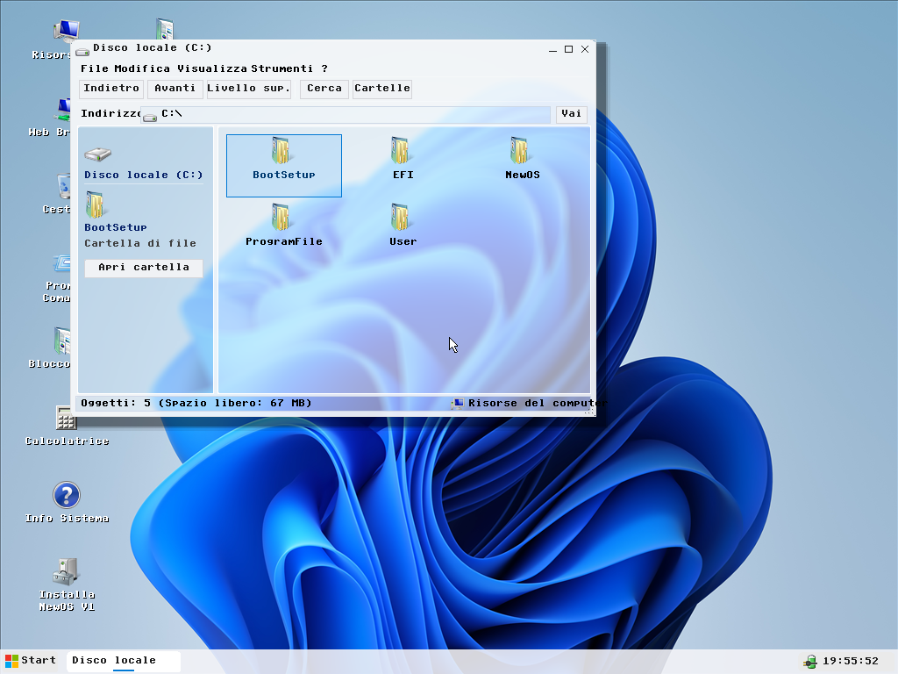
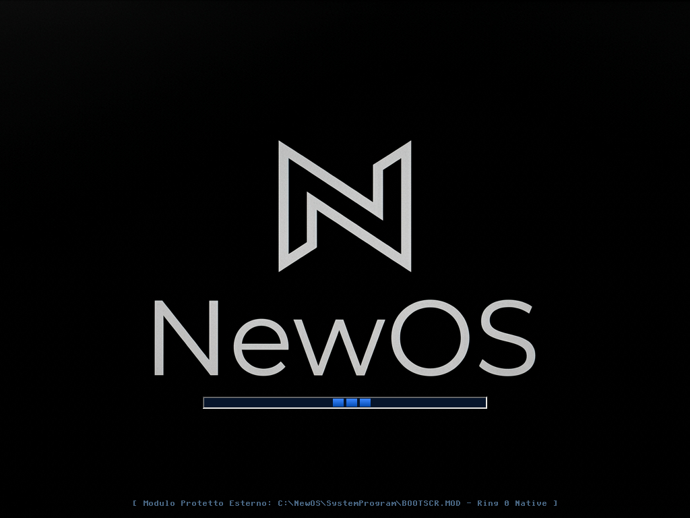
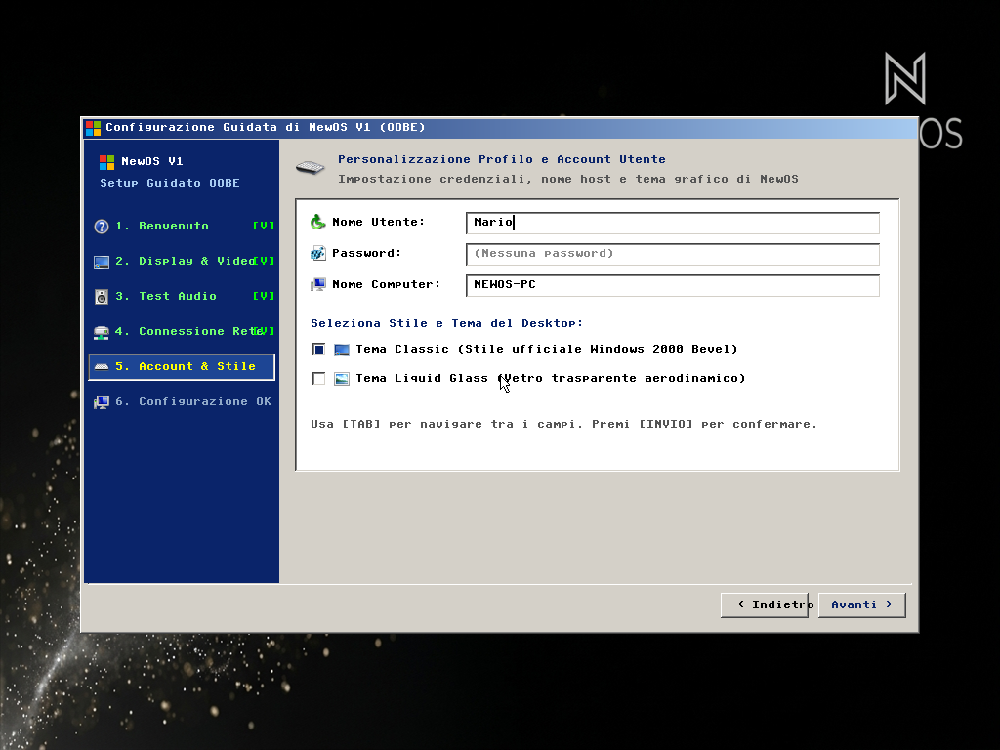
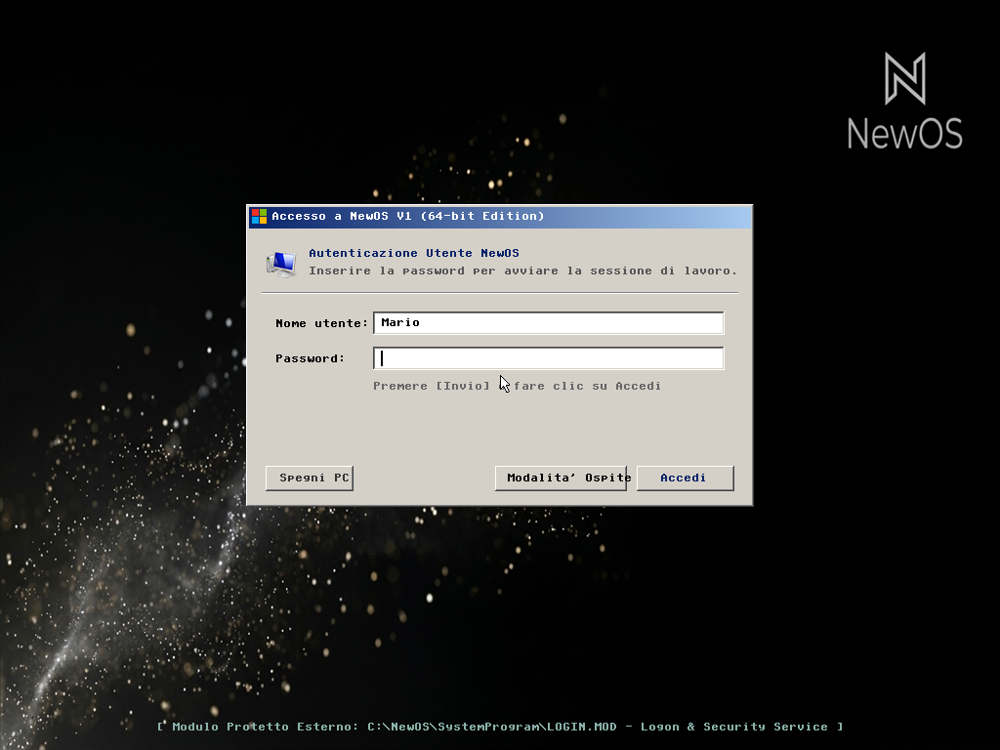
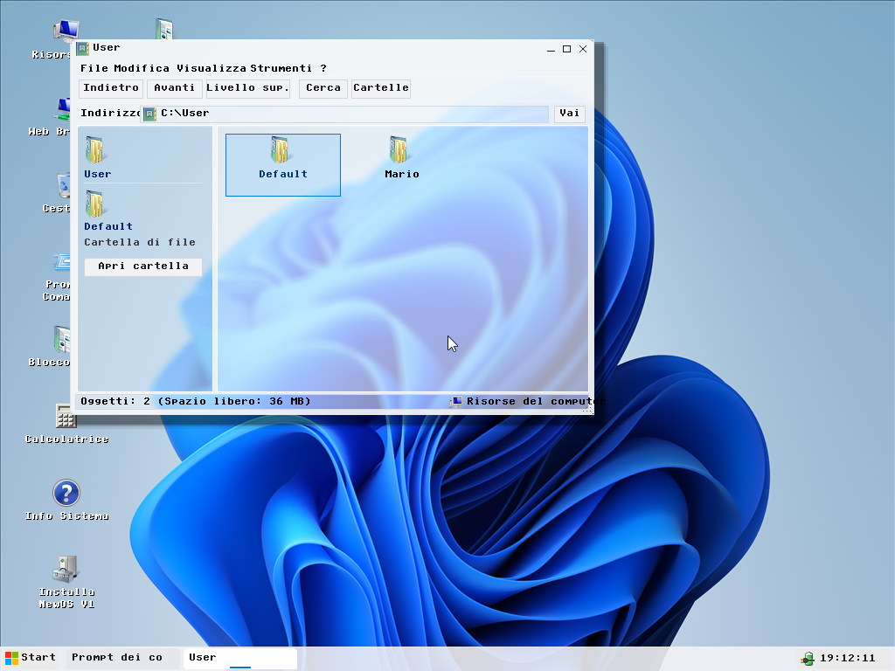
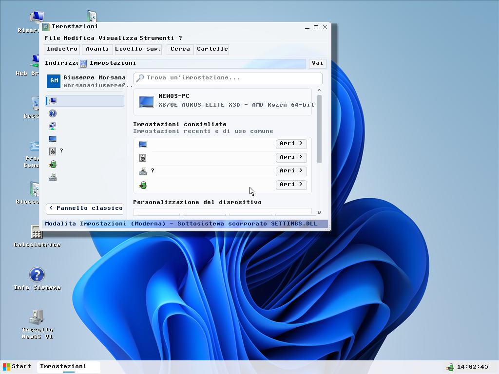
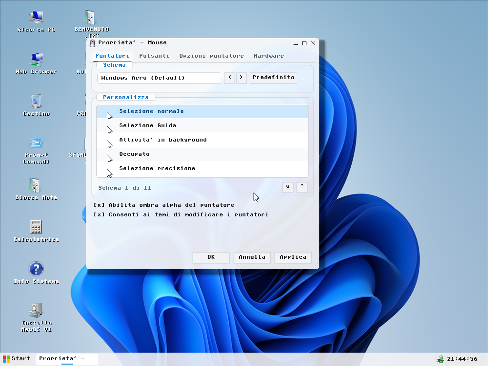
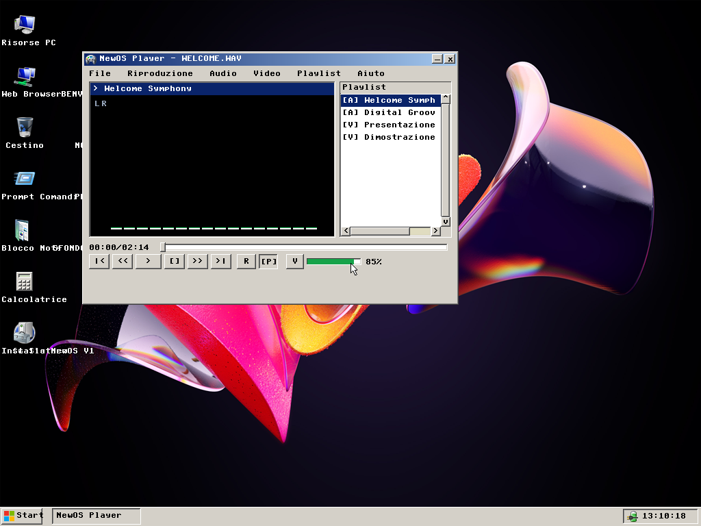
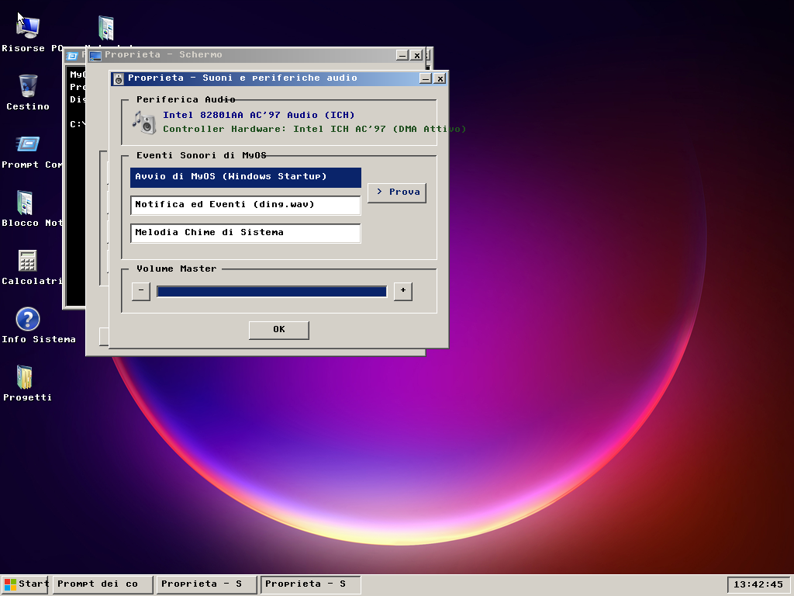

# NewOS V1 (64-bit)

[]()
[-blue.svg)]()
[]()
[]()
[]()
[]()

**NewOS V1** è un sistema operativo nativo a 64-bit scritto in C ed Assembly per architettura **x86_64**, con architettura ibrida a kernel protetto e sottosistemi applicativi/librerie scorporati (*Out-of-Kernel*), interfaccia grafica multi-tema (**Liquid Glass**, **Mica Dark/Light** e **Classic Windows 2000**), supporto completo a dischi fisici MBR/GPT ed exFAT, stack di rete completo (IPv4, TCP, UDP, DHCP, DNS) e browser web integrato.

<p align="center">
  
  <br />
  <em>Ambiente Desktop di NewOS V1 (64-bit) con tema Liquid Glass attivo, griglia icone anti-collisione ed Esplora Risorse su Disco locale (C:).</em>
</p>

---

## Caratteristiche Principali

### 1. Bootloader Ibrido Dual-Mode (BIOS & UEFI), OOBE e Autenticazione Protetta
- **BIOS Legacy (MBR + Stage 2)**:
  - MBR a 16-bit (`boot/bootsect.asm`).
  - Stage 2 a 16/32/64-bit (`boot/stage2.asm`) con rilevamento memoria E820, VESA VBE 1024x768 @ 32bpp LFB, abilitazione linea A20, mapping PML4 a 4 livelli (4 GB identity mapping con Huge Pages da 2 MB) e passaggio sicuro a Long Mode 64-bit.
  - Limite di caricamento settori CHS impostato rigorosamente a 960 settori (480 KB).
- **UEFI Nativo 64-bit (`BOOTX64.EFI`)**:
  - Bootloader UEFI conforme alle specifiche UEFI 2.x x86_64.
  - Partizione EFI System Partition (ESP) FAT32 a LBA 256000 (`Type 0xEF`).
- **Bypass Automatico del Boot Manager Post-Installazione (`BYPASS_BOOT.md`)**:
  - Una volta completata la prima configurazione (`OOBECompleted=1` / `SetupStage=Completed`), il sistema salta automaticamente il menu di avvio interattivo caricando direttamente la schermata di logon protetta (`LOGIN.MOD`), mantenendo il supporto a `F8` / `ESC` per il menu di emergenza.
- **Migrazione e Creazione Dinamica del Profilo Utente in OOBE (`USER_PROFILE_OOBE.md`)**:
  - Durante il Passo 4 della procedura guidata `OOBE.MOD`, il nome account scelto dall'utente viene migrato atomicamente sul file system exFAT (`C:\User\<NomeUtente>\`), aggiornando `OOBE.INI`, `USER.CFG` e il Registro di Sistema e precompilando automaticamente `LOGIN.MOD` ai successivi riavvii.

| Splash Screen (`BOOTSCR.MOD`) | Procedura Guidata OOBE (`OOBE.MOD`) | Accesso Protetto (`LOGIN.MOD`) |
| :---: | :---: | :---: |
|  |  |  |
| *Modulo di avvio firmato `BOOTSCR.MOD`* | *Passo 4 OOBE: creazione profilo personalizzato* | *Logon diretto post-OOBE con account migrato* |

---

### 2. Kernel Core Protetto (~326 KB / 480 KB)
- **Budget Kernel Rispettato**: Dimensione di `kernel.bin` contenuta a **333.568 byte (~325,7 KB)** grazie allo scorporo delle librerie dinamiche in `C:\NewOS\SystemLibrary\`, ampiamente inferiore al vincolo di 480 KB (491.520 byte).
- **Separazione Privilegi Ring 0 / Ring 3**:
  - Istruzioni native `SYSCALL` e `SYSRET` per le chiamate di sistema (`kernel/arch/x86_64/syscall.c`).
  - Protezione della memoria virtuale con Supervisor bit nelle tabelle PML4 (`kernel/mm/paging.c`).
- **Multitasking & Multi-Core SMP**:
  - Supporto Symmetric Multiprocessing (SMP) per architetture x86_64 con AP trampoline (`kernel/arch/x86_64/smp.c`).
  - Scheduler cooperativo e preemptivo con salvataggio contesti e priorità di esecuzione (`kernel/arch/x86_64/sched.c`).
  - Canali di comunicazione inter-processo IPC a coda di messaggi sicura e piping shell (`kernel/ipc/ipc.c`).
- **Allocatore di Memoria & Heap**:
  - Heap dinamico di sistema (`kmalloc`, `kfree`, `kcalloc`, `krealloc`).
- **Crittografia Hardware & Registro Sicuro**:
  - Motore di cifratura **AES-256** integrato (`kernel/lib/aes256.c`).
  - Registro di configurazione con accesso in sola lettura pre-desktop e scrittura abilitata solo a sessione autenticata (`kernel/fs/registry.c`).

---

### 3. File System, Gestione Dischi e Isolamento Profili (`C:\User\`)
- **exFAT Nativo R/W**: Allocazione dinamica cluster a 4 KB, scansione root e sottocartelle, creazione/modifica/rinomina/cancellazione file e directory con flush sincronizzato della cache settori e auto-ripristino VBR di backup.
- **NTFS-3G R/W**: Lettura e scrittura completa su volumi NTFS, parsing della MFT (Master File Table) e gestione Data Runs.
- **ISO 9660 & Joliet**: Supporto per dischi CD/DVD con codifica Unicode UCS-2.
- **UDF 1.02 & 2.50**: Supporto per dischi DVD-Video e Blu-Ray Disc.
- **RamFS**: Unità disco volatile ad alte prestazioni in memoria RAM (`R:\`).
- **Supporto GPT & MBR**: Rilevamento automatico geometrie e tabelle di partizione per dischi e supporti USB.

| Struttura Radice `C:\` in Esplora Risorse | Directory Profili Utente `C:\User\` post-OOBE |
| :---: | :---: |
|  |  |
| *Gerarchia di sistema in `C:\NewOS`, `C:\ProgramFile` e `C:\User`* | *Migrazione atomica del profilo utente in `C:\User\Mario`* |

---

### 4. Driver Hardware & Periferiche Bare-Metal
- **Storage**: Controller AHCI SATA (DMA/Interrupt) e ATA/IDE PIO 28-bit + ATAPI per lettori ottici CD/DVD.
- **USB Stack**: Controller xHCI (USB 3.x/USB4), UHCI (USB 1.1), OHCI, periferiche HID (mouse e tastiera) e USB Mass Storage BOT con AutoPlay automatico e handoff BIOS/OS.
- **Audio**: Codec stereo AC97 a 44.1 kHz con mixer di sistema e riproduzione di file PCM `.WAV`.
- **Grafica**: Driver VESA VBE e Bochs/QEMU BGA fino a 1920x1080 @ 32bpp.
- **Network**: Driver Intel PRO/1000 MT (E1000 Gigabit), Realtek RTL8139 e Wi-Fi con stack Ethernet, ARP, IPv4, ICMP Ping, UDP, TCP, DHCP e DNS nativo RFC 1035.

---

### 5. Interfaccia Grafica, Temi Dinamici e Desktop Grid System
- **Supporto Multi-Tema Nativo (Classic Windows 2000, Liquid Glass, Mica Dark & Light)**:
  - Rendering classico Windows 2000 (`COLOR_BTNFACE = 0xD4D0C8`, bordi 3D bevel/sunken) oppure moderno traslucido con alpha-blending, curvature parametriche e riflessi speculari.
- **Sistema a Griglia Desktop Anti-Collisione**:
  - Dimensioni cella griglia: 116x88 pixel, con margini perimetrali di sicurezza e calcolo dinamico delle righe disponibili.
  - Word-wrapping automatico a due righe per etichette superiori a 12 caratteri e riallineamento automatico su cambio risoluzione.
- **Menu Contestuale Indipendente & Autoaggiornante**:
  - Scorporato in `kernel/gui/context_menu.c`, legge dinamicamente le associazioni file da `REGISTRY.DAT` (`.TXT`, `.NOR`, `.WAV`, `.MP3`, `.BMP`, ecc.).

---

### 6. Applicazioni, Pannello di Controllo e Sottosistemi Scorporati
Tutte le applicazioni accessorie e i tool di sistema sono organizzati come moduli indipendenti:
- [`explorer/`](file:///c:/Users/morga/Desktop/MyOS/explorer/): **Esplora Risorse** con Web View preview, Tree View laterale, barra indirizzi, dialoghi di proprietà e modalità Impostazioni Moderne.
- [`control_panel/`](file:///c:/Users/morga/Desktop/MyOS/control_panel/): **Pannello di Controllo** con supporto dual-mode (Vista Classica Windows 2000 e Vista Moderna Impostazioni) e applet per Proprietà Schermo (`DESK.CPL`), Mouse (`MAIN.CPL`), Audio (`MMSYS.CPL`), Alimentazione (`POWERCFG.CPL`), Gestione Periferiche (`DEVMGMT.CPL`) e Sistema (`SYSDM.CPL`).
- [`oobe/`](file:///c:/Users/morga/Desktop/MyOS/oobe/): **Procedura Guidata OOBE** in 6 passi (Benvenuto, Schermo, Test Audio, Rete, Account, Conclusione).
- [`notepad/`](file:///c:/Users/morga/Desktop/MyOS/notepad/): **Blocco Note** con supporto editing testo, salvataggio e apertura file.
- [`calculator/`](file:///c:/Users/morga/Desktop/MyOS/calculator/): **Calcolatrice Digitale** con display numerico ed operazioni standard.
- [`player/`](file:///c:/Users/morga/Desktop/MyOS/player/): **NewOS Media Player** con visualizzatore spettro sonoro animato, playlist e controllo volume.
- [`rules_viewer/`](file:///c:/Users/morga/Desktop/MyOS/rules_viewer/): **Visualizzatore Regole** per documenti e policy di sistema in formato `.NOR` (tramite `RULES.DLL`).
- [`whatsnew/`](file:///c:/Users/morga/Desktop/MyOS/whatsnew/): **Novità del Sistema** con storico release e funzionalità per gli utenti (tramite `WHATSNEW.DLL`).
- [`autoplay/`](file:///c:/Users/morga/Desktop/MyOS/autoplay/): **Gestione AutoPlay** per rilevamento e apertura automatica di chiavette USB e dischi.
- [`taskmgr/`](file:///c:/Users/morga/Desktop/MyOS/taskmgr/): **Gestione Attività** con grafici di utilizzo CPU e memoria, tabella processi e canali IPC.
- [`WebBrowser/`](file:///c:/Users/morga/Desktop/MyOS/WebBrowser/): **NewSoft Web Browser** con motore di rendering HTML integrato e navigazione web.

| Impostazioni Moderne (`SETTINGS.DLL`) | Proprietà Mouse e Schemi (`MAIN.CPL` / `CURSORMGR.DLL`) |
| :---: | :---: |
|  |  |
| *Interfaccia Impostazioni Moderna renderizzata fuori dal kernel da `SETTINGS.DLL`* | *Applet Proprietà Mouse a 4 schede con gestione schemi cursore Aero/Glass* |

| NewOS Media Player (`PLAYER.EXE`) | Stile Classico Windows 2000 & Sottosistema Audio AC97 |
| :---: | :---: |
|  |  |
| *Riproduzione multimediale `.WAV` con analizzatore di spettro e playlist* | *Tema Classic Bevel Windows 2000 con Proprietà Audio AC97 e Prompt dei Comandi* |

---

### 7. Librerie Dinamiche Out-of-Kernel (`C:\NewOS\SystemLibrary\`)
In base alla Direttiva Architetturale (Regola 9), i sottosistemi grafici e applicativi avanzati risiedono fuori dal Kernel Mode come librerie dinamiche `.DLL` firmate (`NOSM` + CRC32) affiancate dai rispettivi descrittori `.INI`:
- **`THEMEMGR.DLL` & `THEMEMGR.INI`**: Scansione autonoma, decodifica file `.THEMES` / `.THM`, parsing INI e motore di scripting procedurale `[RenderScripts]`.
- **`CURSORMGR.DLL` & `CURSORMGR.INI`**: Gestione schemi di puntatori del mouse, decodifica `.CUR`/`.ANI` e ombre alpha.
- **`SETTINGS.DLL` & `SETTINGS.INI`**: Interfaccia grafica moderna delle Impostazioni di Sistema con navigazione per categorie e barra di scorrimento.
- **`WHATSNEW.DLL` & `WHATSNEW.INI`**: Finestra dinamica delle novità post-aggiornamento.
- **`RULES.DLL` & `RULES.INI`**: Decodifica e visualizzazione protetta delle direttive ufficiali `.NOR`.

#### Gestione Avanzata dei File Tema (`.THEMES` e `.THM`)
Il sistema di personalizzazione visiva di NewOS è **interamente pilotato dal file del tema**:
1. **Controllo Granulare di Curvature e Bordi**:
   - Raggi indipendenti per finestre (`CornerRadius`, `BorderRadius`), pulsanti (`ButtonRadius`, `ButtonBorderRadius`), schede (`TabRadius`), campi di input (`InputRadius`), pannelli laterali (`PanelRadius`), taskbar (`TaskbarBtnRadius`), pulsante Start (`StartBtnRadius`) e area di notifica (`TrayRadius`).
   - Flag di raccordo automatico: `BorderFollowsCorner` e `ControlBorderFollowsRadius`.
2. **Motore di Scripting di Rendering Avanzato (`[RenderScripts]`) in `THEMEMGR.DLL`**:
   - Pipeline dichiarativa per `TitlebarScript`, `ButtonScript`, `PanelScript`, `ProgressScript`, `SelectionScript`, `TaskbarScript`, `RenderScript`.
   - Macro grafiche supportate: `SPECULAR_ARC`, `VERTICAL_GLOSS`, `HIGHLIGHT_EDGE`, `INNER_HIGHLIGHT`, `ETCHED_LINE`, `CYLINDER_SHADING`, `AURA_BORDER`, `NOISE_TEXTURE`, `GLASS_TINT`, `GRADIENT`.
   - Documentazione completa disponibile in [`THEME_SPECIFICATION.md`](file:///c:/Users/morga/Desktop/MyOS/THEME_SPECIFICATION.md).

---

## Struttura del Repository

```
├── .agents/                 # Direttive comportamentali e operative dell'Agente AI
├── autoplay/                # Sottosistema AutoPlay USB (autoplay.c, autoplay.ini, LEGGIMI.TXT)
├── boot/                    # Sorgenti Bootloader (bootsect.asm MBR, stage2.asm)
├── bootscreen/              # Sorgenti Bootscreen protetto (BOOTSCR.MOD)
├── BootSetup/               # Programma di installazione con decifratore AES-256 (BOOTSETUP.MOD)
├── calculator/              # Sottosistema Calcolatrice (calculator.c, calculator.ini, LEGGIMI.TXT)
├── control_panel/           # Pannello di Controllo e applet .CPL (display, mouse, sound, power, devmgmt, about)
├── explorer/                # Sottosistema Esplora Risorse (explorer.c, explorer.ini, LEGGIMI.TXT)
├── kernel/                  # Codice sorgente del Kernel 64-bit
│   ├── apps/                # Shell CMD, Regedit, Boot Menu e header bridge
│   ├── arch/x86_64/         # Syscall, SMP, Scheduler, IDT, PIC, AP trampoline, entry asm
│   ├── drivers/             # Driver AC97, AHCI, ATA, PCI, VGA, Power, Timer, USB (xHCI/UHCI/OHCI), Net
│   ├── fs/                  # exFAT, NTFS-3G, ISO 9660, UDF, RamFS, VFS e Registry cifrato AES-256
│   ├── gui/                 # Window Manager, griglia desktop, menu contestuale, loader DLL (theme/cursor/settings)
│   ├── ipc/                 # Meccanismi di comunicazione inter-processo (IPC)
│   ├── lib/                 # Librerie freestanding, AES-256, gestione e migrazione profili utente
│   ├── mm/                  # Gestione memoria, heap manager e paging PML4 a 4 livelli
│   └── net/                 # Network stack (Ethernet, ARP, IPv4, ICMP, UDP, TCP, DHCP, DNS, TLS)
├── loginscreen/             # Schermata di autenticazione utente (LOGIN.MOD)
├── logoutscreen/            # Schermata di disconnessione e spegnimento (LOGOUT.MOD)
├── MultimediaCodec/         # Moduli Codec indipendenti (.CDC: WAV, MP3, FLAC, AVI, AV1, MP4)
├── notepad/                 # Sottosistema Blocco Note (notepad.c, notepad.ini, LEGGIMI.TXT)
├── oobe/                    # Sottosistema procedura guidata OOBE (oobe.c, oobe.ini, LEGGIMI.TXT)
├── player/                  # Sottosistema NewOS Media Player (player.c, player.ini, LEGGIMI.TXT)
├── Release/                 # Cartella di rilascio ufficiale (BOOTX64.EFI, SYSTEM.PAK, moduli .MOD)
├── resources/               # Icone 32/16 bit, sfondi, schemi cursori, suoni PCM .WAV e font bitmap
├── rules/                   # Regole di comportamento e sviluppo (comportamenti.md)
├── rules_viewer/            # Loader visualizzatore regole .NOR (rules_viewer.c, LEGGIMI.TXT)
├── sources/                 # Snapshot portabile dei sorgenti distribuito nell'immagine ISO
├── SystemLibrary/           # Librerie dinamiche out-of-kernel (.DLL e .INI: THEMEMGR, CURSORMGR, SETTINGS, WHATSNEW, RULES)
├── taskmgr/                 # Sottosistema Gestione Attività (taskmgr.c, taskmgr.ini, LEGGIMI.TXT)
├── tools/                   # Toolchain Node.js/PowerShell (build.js, mkexfat.js, mkiso.js, suite di test QEMU)
├── WebBrowser/              # NewSoft Web Browser nativo
├── whatsnew/                # Loader Novità del Sistema (whatsnew.c, whatsnew.ini, LEGGIMI.TXT)
├── AGENTS.md                # Direttive e vincoli primari del progetto
├── BYPASS_BOOT.md           # Specifica tecnica del bypass automatico del Boot Manager
├── CHECKPOINT.md            # Cronologia dettagliata di tutte le sessioni di sviluppo
├── README.md                # Presentazione e documentazione ufficiale del progetto
├── THEME_SPECIFICATION.md   # Specifica completa dei temi .THEMES/.THM e linguaggio RenderScripts
└── USER_PROFILE_OOBE.md     # Specifica tecnica di migrazione e creazione dinamica del profilo utente in OOBE
```

---

## Compilazione e Avvio

### Prerequisiti
- [NASM](https://www.nasm.us/) (Netwide Assembler)
- [LLVM/Clang](https://llvm.org/) con target `x86_64-unknown-none-elf` e linker `ld.lld`
- [Node.js](https://nodejs.org/) (versione 18 o superiore)
- [QEMU](https://www.qemu.org/) per il collaudo ed emulazione

### Compilazione del Sistema
Per compilare il bootloader BIOS/UEFI, il kernel, i moduli protetti `.MOD`, i codec `.CDC` e le librerie `.DLL`, impacchettare e cifrare `SYSTEM.PAK`, formattare l'unità exFAT e generare i supporti avviabili (`NewOS_V1.iso`, `NewOS_V1.img`, `NewOS_V1.vdi`):
```bash
node tools/build.js
```

### Avvio in QEMU
Per eseguire il sistema operativo in emulazione completa:
```bash
tools\qemu-system-x86_64.exe -cdrom NewOS_V1.iso -m 256M -vga std -device AC97 -netdev user,id=net0 -device e1000,netdev=net0
```

---

## Licenza e Diritti
Copyright (C) @ Newspoint Software - NewSoft - NewOS V1. Tutti i diritti riservati.
