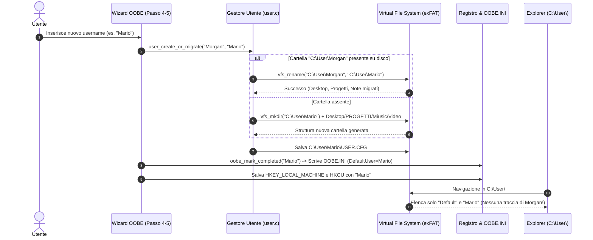

# NewOS V1 (64-bit) — Specifiche Tecniche
## Architettura di Migrazione e Creazione Dinamica Profilo Utente in OOBE

**Data Documento**: 28 Ottobre 2026  
**Stato Specifica**: Approvata (Pronta per Implementazione)  
**Autore**: Morgan / NewSoft Architect  
**Target Kernel**: Ring 0 (VFS, User Management) / Userland (OOBE Wizard, Explorer, Login)  

---

### 1. Obiettivo dell'Ottimizzazione (UX & Integrità File System)

Durante la procedura guidata di prima configurazione **OOBE** (Passo 4: *Profilo Utente & Personalizzazione*), l'utente ha la facoltà di impostare un proprio nome account personalizzato (ad esempio `Mario`, `Giuseppe`, `Admin`) in sostituzione del nome predefinito di sviluppo (`Morgan`).

Tuttavia, nell'attuale implementazione si riscontra un'anomalia di persistenza:
- Al termine dell'OOBE e all'approdo sul Desktop, aprendo *Risorse del computer* e navigando in `C:\User\`, **è visibile unicamente la cartella predefinita `Morgan`** (oltre a `Default`), mentre la cartella del nuovo utente non esiste fisicamente sul file system.
- Inoltre, al successivo riavvio della macchina, la schermata protetta [`LOGIN.MOD`](file:///c:/Users/morga/Desktop/MyOS/loginscreen/loginscreen.c) continua a proporre `"Morgan"` come utente predefinito, sovrascrivendo l'esperienza utente configurata nel wizard.

L'obiettivo di questa specifica è introdurre un meccanismo di **Migrazione e Creazione Atomica del Profilo Utente** direttamente a livello VFS/exFAT, garantendo che:
1. La cartella fisica sul disco exFAT rifletta fedelmente il nuovo nome (`C:\User\<NuovoUtente>\`).
2. Tutti i documenti, la cartella `Desktop\`, `PROGETTI\`, `Miusic\` e `Video\` vengano preservati o creati sotto il nuovo percorso.
3. Le chiavi del Registro di Sistema, il file `OOBE.INI` e il file `USER.CFG` memorizzino coerentemente il nuovo account.
4. [`LOGIN.MOD`](file:///c:/Users/morga/Desktop/MyOS/loginscreen/loginscreen.c) e [`LOGOUT.MOD`](file:///c:/Users/morga/Desktop/MyOS/logoutscreen/logoutscreen.c) interroghino dinamicamente l'utente configurato senza hardcoding.

---

### 2. Analisi Dettagliata delle Cause Radice

1. **Mancanza di Interazione con il File System sul Cambio Nome**:
   - L'archivio di sistema [`SYSTEM.PAK`](file:///c:/Users/morga/Desktop/MyOS/Release/BootSetup/SYSTEM.PAK) estrae su `C:\` la struttura di base `User/Morgan/...`.
   - In [`oobe/oobe.c`](file:///c:/Users/morga/Desktop/MyOS/oobe/oobe.c), al momento del salvataggio del profilo viene aggiornata la struttura in memoria RAM ([`user_set_profile()`](file:///c:/Users/morga/Desktop/MyOS/kernel/lib/user.c#L72)), ma **nessuna chiamata di rinomina ([`vfs_rename()`](file:///c:/Users/morga/Desktop/MyOS/kernel/fs/vfs.c#L516)) o creazione ([`vfs_mkdir()`](file:///c:/Users/morga/Desktop/MyOS/kernel/fs/vfs.c#L427)) viene eseguita su disco**.
   - Di conseguenza, in `C:\User\` rimane unicamente la directory fisica preesistente `Morgan`.

2. **Fallimento Silenzioso del Salvataggio `USER.CFG`**:
   - La funzione [`user_save_config()`](file:///c:/Users/morga/Desktop/MyOS/kernel/lib/user.c#L93) tenta di salvare il file di configurazione in `C:\User\<NuovoNome>\USER.CFG`.
   - Non esistendo la directory `C:\User\<NuovoNome>\`, la chiamata a `vfs_write_entire_file_inplace()` fallisce silenziosamente.

3. **Hardcoding nei File di Inizializzazione di Sistema**:
   - [`oobe/oobe.c`](file:///c:/Users/morga/Desktop/MyOS/oobe/oobe.c#L168): [`oobe_mark_completed()`](file:///c:/Users/morga/Desktop/MyOS/oobe/oobe.c#L156) scrive hardcoded `DefaultUser=Morgan` all'interno di `C:\NewOS\OOBE\OOBE.INI`.
   - [`kernel/lib/user.c`](file:///c:/Users/morga/Desktop/MyOS/kernel/lib/user.c#L22): all'avvio del kernel, [`user_init()`](file:///c:/Users/morga/Desktop/MyOS/kernel/lib/user.c#L9) tenta sempre di aprire `C:\User\Morgan\USER.CFG`. Non trovando il file del nuovo utente, ripristina il nome fallback `"Morgan"`.
   - [`kernel/gui/screen_mgr.c`](file:///c:/Users/morga/Desktop/MyOS/kernel/gui/screen_mgr.c#L504): i parametri di invocazione di `LOGIN.MOD` e `LOGOUT.MOD` contengono la costante `.default_user = "Morgan"`.

---

### 3. Flussi di Esecuzione Comparati



---

### 4. Dettaglio Implementativo per Livelli

#### Livello 1: Sottosistema Gestione Utente ([`kernel/lib/user.c`](file:///c:/Users/morga/Desktop/MyOS/kernel/lib/user.c), [`user.h`](file:///c:/Users/morga/Desktop/MyOS/kernel/include/user.h))
1. **Dichiarazione e implementazione di `user_create_or_migrate`**:
   ```c
   bool user_create_or_migrate(const char* old_username, const char* new_username);
   ```
   - Normalizza i nomi rimuovendo spazi superflui e verificando che `new_username` sia valido (non vuoto e non uguale a `.` o `..`).
   - Se `new_username` è identico a `old_username`, assicura solo la presenza della directory.
   - Se `old_username` (`Morgan`) esiste su `C:\User\Morgan`, esegue:
     ```c
     vfs_rename("C:\\User\\Morgan", "C:\\User\\<new_username>");
     ```
   - In caso di fallback (cartella di origine non esistente o errore di rinomina), crea la gerarchia completa con [`vfs_mkdir()`](file:///c:/Users/morga/Desktop/MyOS/kernel/fs/vfs.c#L427):
     - `C:\User\<new_username>`
     - `C:\User\<new_username>\Desktop`
     - `C:\User\<new_username>\Desktop\PROGETTI`
     - `C:\User\<new_username>\Miusic`
     - `C:\User\<new_username>\Video`
   - Inizializza `NOTE.TXT` e `BENVENUTO.TXT` personalizzati nel nuovo desktop.
   - Salva `C:\User\<new_username>\USER.CFG` con parametri validi (`INSTALLED=1`).

2. **Rilevamento Dinamico all'Avvio in `user_init()`**:
   - `user_init()` deve prioritariamente interrogare `C:\NewOS\OOBE\OOBE.INI` leggendo la chiave `DefaultUser=`.
   - Se trovata, imposta `current_user.username` sul nome reale configurato.
   - Carica di conseguenza `C:\User\<DefaultUser>\USER.CFG`.

#### Livello 2: Procedura Guidata OOBE ([`oobe/oobe.c`](file:///c:/Users/morga/Desktop/MyOS/oobe/oobe.c), [`oobe.h`](file:///c:/Users/morga/Desktop/MyOS/oobe/oobe.h))
1. **Parametrizzazione di `oobe_mark_completed`**:
   ```c
   void oobe_mark_completed_with_user(const char* username);
   ```
   - Scrive dinamicamente in `C:\NewOS\OOBE\OOBE.INI`:
     ```ini
     [OOBE]
     Completed=1
     SetupStage=Completed
     Language=IT_IT
     DefaultUser=<state->username>
     AllowSkip=1
     ```
2. **Aggiornamento Fase Finale OOBE (Passo 5)**:
   - Chiama `user_create_or_migrate("Morgan", state.username)`.
   - Chiama `user_set_profile(state.username, state.password, state.computer_name, state.selected_theme, 0, true)`.
   - Chiama `user_save_config()`.
   - Scrive nel Registro di Sistema:
     - `HKEY_LOCAL_MACHINE\NEWOS\SYSTEM` -> `DefaultUser = state.username`
     - `HKEY_CURRENT_USER\NEWOS\PREFERENCES` -> `Username = state.username`
     - `HKEY_CURRENT_USER\DESKTOP` -> `UserDesktopPath = C:\User\<state.username>\Desktop`
   - Salva il registro su disco con [`registry_save_to_disk()`](file:///c:/Users/morga/Desktop/MyOS/kernel/fs/registry.c#L634).

#### Livello 3: Moduli di Autenticazione e Logout ([`kernel/gui/screen_mgr.c`](file:///c:/Users/morga/Desktop/MyOS/kernel/gui/screen_mgr.c))
1. In [`screen_mgr_run_loginscreen()`](file:///c:/Users/morga/Desktop/MyOS/kernel/gui/screen_mgr.c#L484):
   - Rileva l'utente corrente da `user_get_current()`.
   - Imposta `p.default_user` con il nome reale (con fallback a `"Morgan"` solo se nullo).
2. In [`screen_mgr_run_logoutscreen()`](file:///c:/Users/morga/Desktop/MyOS/kernel/gui/screen_mgr.c#L516):
   - Imposta `p.current_user` con il nome reale attivo.

---

### 5. Piano Operativo di Implementazione e Validazione

| Fase | File Coinvolti | Descrizione dell'Attività | Verifica & Output |
| :--- | :--- | :--- | :--- |
| **Fase 1** | [`kernel/lib/user.c`](file:///c:/Users/morga/Desktop/MyOS/kernel/lib/user.c), [`user.h`](file:///c:/Users/morga/Desktop/MyOS/kernel/include/user.h) | Aggiunta `user_create_or_migrate()`, aggiornamento `user_init()` e `user_save_config()`. | Compilazione pulita, zero warning. |
| **Fase 2** | [`oobe/oobe.c`](file:///c:/Users/morga/Desktop/MyOS/oobe/oobe.c), [`oobe.h`](file:///c:/Users/morga/Desktop/MyOS/oobe/oobe.h) | Parametrizzazione `oobe_mark_completed_with_user()` e migrazione cartella al Passo 5. | Nessun hardcoding di "Morgan" nei file generati. |
| **Fase 3** | [`kernel/gui/screen_mgr.c`](file:///c:/Users/morga/Desktop/MyOS/kernel/gui/screen_mgr.c) | Rimozione parametri fissi in login e logout screen. | `LOGIN.MOD` riceve l'utente configurato. |
| **Fase 4** | [`tools/build.js`](file:///c:/Users/morga/Desktop/MyOS/tools/build.js), [`sources/`](file:///c:/Users/morga/Desktop/MyOS/sources) | Compilazione totale, verifica budget kernel (< 480 KB), sincronizzazione snapshot. | `kernel.bin` < 480 KB (zero warning, zero errori). |
| **Fase 5** | [`tools/test_custom_user_oobe.js`](file:///c:/Users/morga/Desktop/MyOS/tools/test_custom_user_oobe.js) | Creazione test automatico QEMU con utente personalizzato (es. `"Mario"`). | Screenshot di Esplora Risorse in `C:\User` con la cartella `Mario` presente e `Morgan` assente. |

---

### 6. Criteri di Accettazione e Collaudo

1. **Integrità del File System `C:\User\`**:
   - `DIR C:\User` deve elencare esclusivamente `Default` e la cartella del nome utente scelto dall'utente finale (es. `Mario`).
   - La cartella `Morgan` deve risultare completamente assente o rinominata.
2. **Conservazione Risorse Personali**:
   - La nuova cartella `C:\User\<nome>\Desktop` deve contenere i file personali e collegamenti predefiniti.
3. **Schermata di Accesso (`LOGIN.MOD`)**:
   - All'avvio successivo la maschera di logon deve pre-compilare il campo *Nome utente* con il nuovo account configurato.
4. **Vincoli di Sistema**:
   - Dimensione `kernel.bin` rigorosamente inferiore a **491.520 byte (480 KB)**.
   - Zero warning del compilatore Clang e linking LLD perfetto.
